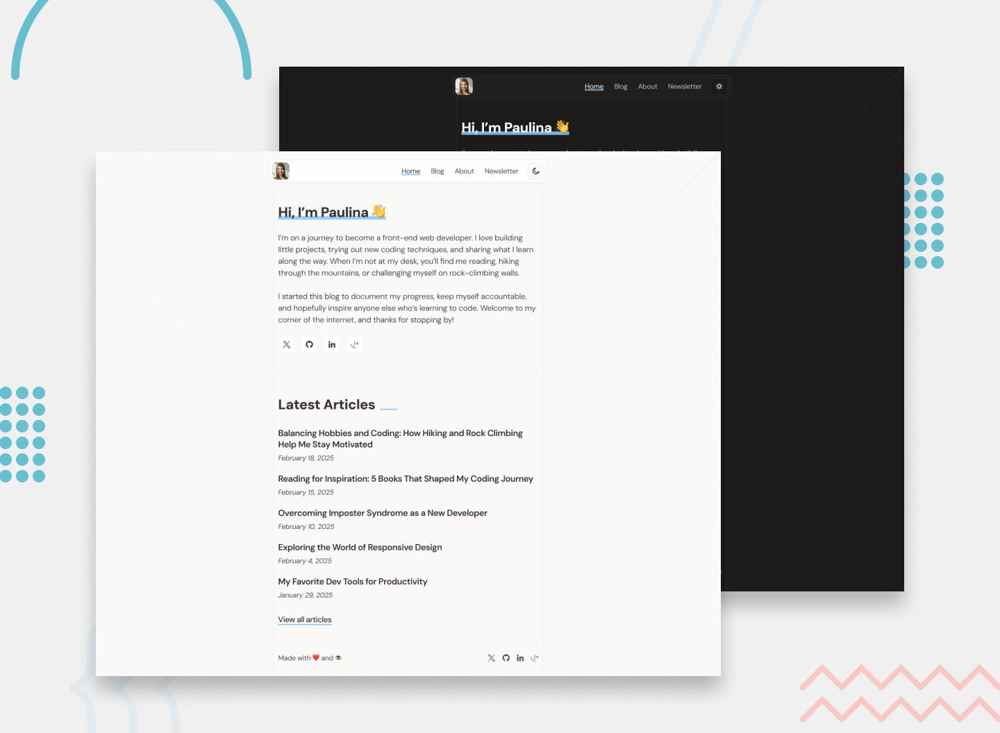

# Frontend Mentor - Personal blog solution

This is a solution to the [Personal blog challenge on Frontend Mentor](https://www.frontendmentor.io/challenges/personal-blog-lJpVCnmozL). Frontend Mentor challenges help you improve your coding skills by building realistic projects.

I went beyond the static design and turned it into a full-stack app: posts live in MongoDB and are managed through a password-protected admin area with a Markdown editor.

## Table of contents

- [Overview](#overview)
  - [The challenge](#the-challenge)
  - [Beyond the challenge](#beyond-the-challenge)
  - [Screenshot](#screenshot)
  - [Links](#links)
- [My process](#my-process)
  - [Built with](#built-with)
  - [What I learned](#what-i-learned)
  - [Continued development](#continued-development)
  - [Useful resources](#useful-resources)
  - [AI Collaboration](#ai-collaboration)
- [Author](#author)

## Overview

### The challenge

Users should be able to:

- Navigate to all pages by clicking links or using their keyboard
- Read all articles
- Select their color theme
- Submit their email to subscribe to the newsletter
- Receive an error message when the newsletter form is submitted if:
  - The Email Address field is empty
  - The Email Address is not formatted correctly
- Receive a success message if submitted correctly
- View the optimal layout for the interface depending on their device's screen size
- See hover and focus states for all interactive elements on the page

### Beyond the challenge

- Posts are stored in MongoDB (Mongoose) instead of a static JSON file, with a seed script to load the sample articles
- A password-protected admin area (`/admin`) to create, edit, and delete posts
- Rich Markdown editing with MDXEditor; public pages render Markdown with `react-markdown` + `remark-gfm`
- Sessions handled with encrypted cookies (`iron-session`) and bcrypt-hashed admin passwords
- Graceful fallback: without a database connection, public pages read from `src/data/posts.json`
- End-to-end tests with Playwright, including automated accessibility checks (axe-core) for color contrast and spacing in both light and dark themes

### Screenshot



### Links

- Solution URL: [GitHub repository](https://github.com/NguyenDonUET/personal-blog)
- Live Site URL: [Add live site URL here](https://your-live-site-url.com)

## My process

### Built with

- Semantic HTML5 markup
- CSS custom properties
- Flexbox
- CSS Grid
- Mobile-first workflow
- [Next.js](https://nextjs.org/) (App Router, Server Actions, Middleware) - React framework
- [React](https://react.dev/) - JS library
- [TypeScript](https://www.typescriptlang.org/)
- [Tailwind CSS](https://tailwindcss.com/) + [shadcn/ui](https://ui.shadcn.com/) - Styling and accessible UI primitives
- [Zustand](https://zustand.docs.pmnd.rs/) - Client state (theme preference, newsletter form)
- [MongoDB](https://www.mongodb.com/) + [Mongoose](https://mongoosejs.com/) - Database
- [MDXEditor](https://mdxeditor.dev/) - Markdown editor for the admin area
- [iron-session](https://github.com/vvo/iron-session) + [bcryptjs](https://github.com/dcodeIO/bcrypt.js) - Admin authentication
- [Playwright](https://playwright.dev/) + [axe-core](https://github.com/dequelabs/axe-core) - End-to-end and accessibility testing

### What I learned

**Theme selection that respects the OS setting.** The theme preference has three states (`light`, `dark`, `system`) and is persisted to `localStorage` with Zustand's `persist` middleware. When the preference is `system`, the provider listens for OS-level changes so the page updates live:

```ts
if (preference !== "system") return;

const media = window.matchMedia("(prefers-color-scheme: dark)");
media.addEventListener("change", apply);
return () => media.removeEventListener("change", apply);
```

**Accessible form feedback.** The newsletter form disables native browser validation (`noValidate`) so I could show the design's custom messages, then connects them to the input for screen readers. Errors use `role="alert"` so they are announced right away, while the success message uses the politer `role="status"`:

```tsx
<Input
  id="newsletter-email"
  type="email"
  aria-invalid={status === "error"}
  aria-describedby={status !== "idle" ? "newsletter-feedback" : undefined}
/>
```

**Protecting routes on the server.** Admin pages are guarded in Next.js Middleware, which reads the encrypted session cookie before any page renders. Server Actions also call `requireAuth()` themselves, because Middleware only protects page navigation, not direct action calls.

**Testing accessibility automatically.** Instead of only checking contrast by eye, Playwright emulates the light and dark color schemes and runs axe-core against every public route. One lesson: CSS color transitions made axe sample half-faded colors, so the tests disable transitions before scanning.

### Continued development

- Connect the newsletter form to a real email service instead of client-side validation only
- Add draft/published states and image uploads to the admin editor
- Look into rate limiting the admin login
- Keep building the habit of writing accessibility tests alongside features, not after

### Useful resources

- [Next.js documentation](https://nextjs.org/docs) - App Router, Server Actions, and Middleware
- [MDN: ARIA live regions](https://developer.mozilla.org/en-US/docs/Web/Accessibility/ARIA/ARIA_Live_Regions) - Helped me choose between `role="alert"` and `role="status"` for form feedback
- [MDN: prefers-color-scheme](https://developer.mozilla.org/en-US/docs/Web/CSS/@media/prefers-color-scheme) - Detecting the user's OS theme
- [Playwright accessibility testing](https://playwright.dev/docs/accessibility-testing) - Setting up axe-core with Playwright
- [iron-session](https://github.com/vvo/iron-session) - Encrypted cookie sessions for Next.js

### AI Collaboration

I used Cursor's AI agent during this project.

- **How I used it:** discussing architecture trade-offs (static JSON vs. a database, how to protect admin routes), debugging, and writing Playwright accessibility tests.
- **What worked well:** talking through options before writing code, and using it to catch accessibility issues such as color contrast in dark mode.
- **What didn't:** suggestions still needed review and testing. The end-to-end tests were what gave me confidence that changes actually worked.

## Author

- GitHub - [@NguyenDonUET](https://github.com/NguyenDonUET)
- Frontend Mentor - [@yourusername](https://www.frontendmentor.io/profile/yourusername)
